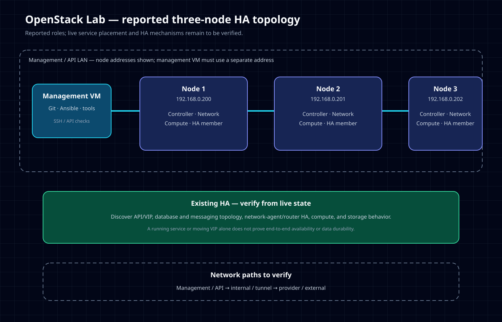

<div align="center">

# OpenStack Lab

### A safe, phase-by-phase learning environment for a small OpenStack cluster

[](docs/INTENSIVE-GUIDE.md)
[](ansible/)

**Learn it. Verify it. Then automate it.**

</div>

> This is a learning lab, not a production installer. The scripts are intentionally read-only: they inspect and validate, but do not reconfigure networking, erase disks, or install OpenStack.

[Start with the guide](docs/INTENSIVE-GUIDE.md) · [Architecture](docs/architecture.md) · [Scripts](scripts/)

## At a glance

| Management | Controller | Network | Compute |
|:--|:--|:--|:--|
| Separate management VM | Node 1 · `192.168.0.200` | Node 2 · `192.168.0.201` | Node 3 · `192.168.0.202` |
| Git, Ansible | Identity, image, control plane | Neutron networking | Nova compute / KVM |

Each physical node has 16 GB RAM, a 4-core Intel i5-6500T, and a USB NIC intended for private connectivity. **The management VM needs its own unique address**—do not overlap it with a node address.



## Start here

```bash
git clone https://github.com/DinosaurKeys/openstack-lab.git
cd openstack-lab
bash scripts/00-local-preflight.sh
```

Review and adjust `inventory/hosts.yml` for your actual hosts and SSH user, then test connectivity:

```bash
ansible-inventory --graph
bash scripts/01-verify-ssh-ansible.sh
```

The first SSH connection may ask you to verify a host key. Confirm it belongs to the intended node. The repository does not store SSH passwords or private keys.

## Learning path

```text
Linux & recovery → SSH/Ansible → discover NICs and disks → networking & time
                   → controller → network → compute → optional storage
                   → failure testing → HA → Terraform → monitoring
```

Do not skip discovery or jump to HA. Complete each phase gate and resume from the first failed check—not from a reinstall. See the [intensive guide](docs/INTENSIVE-GUIDE.md) for the full walkthrough.

## Repository map

| Path | Purpose |
|:--|:--|
| `docs/INTENSIVE-GUIDE.md` | Detailed phases, checks, and recovery guidance |
| `docs/architecture.md` | Network roles, traffic flows, and Mermaid build diagram |
| `diagrams/openstack-lab-architecture.svg` | Standalone topology diagram |
| `inventory/hosts.yml` | Ansible host inventory; review before use |
| `ansible/ansible.cfg` | Project Ansible defaults |
| `scripts/` | Local preflight and read-only node checks |

## Safety boundaries

- Never guess a NIC, gateway, subnet, or disk identity.
- Do not apply network changes without console or other recovery access.
- Existing LVM metadata means a disk may already be in use; do not run `pvcreate` as a tutorial shortcut.
- A VIP alone is not high availability; the first target is a working, non-HA lab.
- Keep local discovery output under `evidence/`; it is ignored by Git because it may contain private infrastructure details.

## Deployment approach

Choose an OpenStack deployment method only after confirming the host OS, release, virtualization support, storage, and network design. The [official installation guide](https://docs.openstack.org/install-guide/) is a manual learning path; [OpenStack-Ansible](https://docs.openstack.org/project-deploy-guide/openstack-ansible/latest/) is a possible later automation path. Do not mix commands from different deployment projects or releases.

## License

No license file is currently included. Until one is added, others do not have an explicit license grant to reuse, modify, or redistribute this repository.

---

This repository is a learning lab, not an unattended production installer.

The design goal is simple: every phase can be run, checked, and understood before the next phase begins. Nothing in `scripts/` changes node networking or installs OpenStack automatically.

## Phase gates

A phase is complete only when its check passes and its evidence is saved.

- Phase 0: `scripts/00-local-preflight.sh`
- Phase 1: `scripts/01-verify-ssh-ansible.sh`
- Phase 2: inspect with `scripts/02-discover-nics-and-disks.sh`; apply networking manually only after review
- Phase 3: `scripts/03-check-time-and-hosts.sh`
- Phase 4 onward: choose deployment documentation after confirming the OS and release

## Recovery rule

When something fails, keep the current files, record the exact command and error locally under ignored `evidence/`, run a read-only diagnostic, change one thing, and rerun the failed phase check. Do not reinstall or wipe a node as a first response.

## Deployment method

Do not install OpenStack until the OS, disks, NICs, and virtualization support are known. The [official installation guide](https://docs.openstack.org/install-guide/) is a manual learning path; [OpenStack-Ansible](https://docs.openstack.org/project-deploy-guide/openstack-ansible/latest/) is a possible later automation path. Confirm its current requirements and choose one supported release—do not mix deployment methods or release instructions.

## Not automated yet

- Network configuration: choosing the wrong NIC or default route can disconnect a node.
- Disk/LVM creation: destructive operations can erase data.
- OpenStack installation: method and release depend on the discovered host environment.
- HA: one controller does not become highly available just by adding a VIP.

This is deliberate: inspect first, then make changes with a recovery path.

## License

No license file is currently included. Until one is added, others do not have an explicit license grant to reuse, modify, or redistribute this repository.

Do not commit private keys, passwords, tokens, generated secret-bearing inventory, or local evidence.
