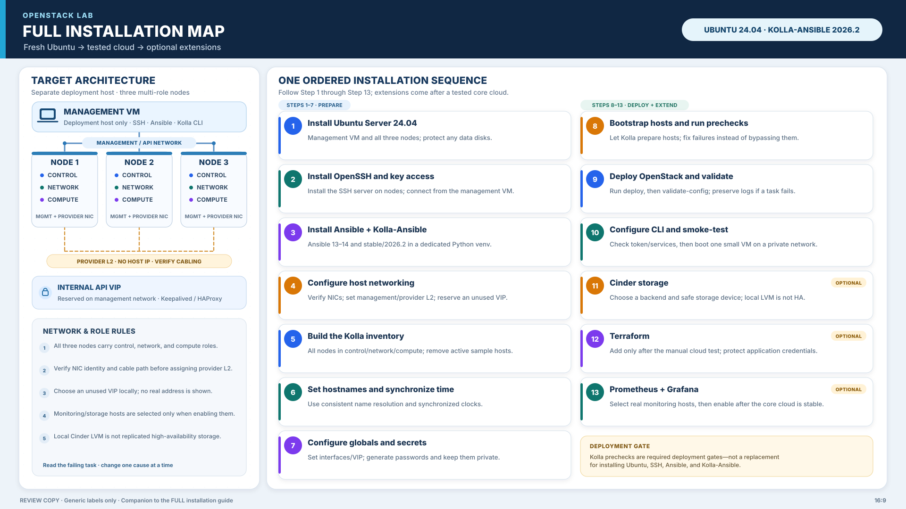

# OpenStack Lab — Full Installation Guide

This is the canonical, from-scratch installation procedure for the lab. It is not a pre-check or a “resume where the existing machines happen to be” guide. Assume the management VM and all three nodes are newly installed; install SSH and Ansible even if the tools are already present on another machine.

Follow the numbered steps in order. The deployment method is Kolla-Ansible, installed in a Python virtual environment on a separate management VM. The pinned baseline is Ubuntu Server 24.04 LTS and Kolla-Ansible `stable/2026.2`; do not mix commands, container images, or constraints from another OpenStack series.

[](../diagrams/openstack-full-installation.svg)

_At-a-glance map only. The numbered instructions below are the authoritative steps and commands; optional Steps 11–13 follow a tested core cloud._

Official references used by this procedure:

- [Kolla-Ansible 2026.2 Quickstart](https://docs.openstack.org/kolla-ansible/2026.2/user/quickstart.html)
- [Kolla-Ansible 2026.2 Multinode Deployment](https://docs.openstack.org/kolla-ansible/2026.2/user/multinode.html)
- [Kolla-Ansible 2026.2 Support Matrix](https://docs.openstack.org/kolla-ansible/2026.2/user/support-matrix)
- [Kolla-Ansible 2026.2 Series Release Notes](https://docs.openstack.org/releasenotes/kolla-ansible/2026.2.html)
- [Kolla-Ansible Production Architecture Guide](https://docs.openstack.org/kolla-ansible/2026.2/admin/production-architecture-guide.html)
- [Kolla-Ansible Cinder Guide](https://docs.openstack.org/kolla-ansible/2026.2/reference/storage/cinder-guide.html)
- [Kolla-Ansible 2026.2 Grafana Guide](https://docs.openstack.org/kolla-ansible/2026.2/reference/logging-and-monitoring/grafana-guide.html)
- [Netplan MAC matching and interface naming](https://netplan.readthedocs.io/en/stable/matching-interface-by-mac-address/)
- [Netplan YAML reference](https://netplan.readthedocs.io/en/stable/netplan-yaml/)
- [Netplan command reference](https://netplan.readthedocs.io/en/stable/cli/)
- [Ubuntu Server installation tutorial](https://ubuntu.com/tutorials/install-ubuntu-server)

## Target installation

| Host | Planned management address | Kolla-Ansible groups |
|:--|:--|:--|
| Management VM | A unique address, not shared with a node | Deployment host only |
| Node 1 | `NODE1_MGMT_IP` | `control`, `network`, `compute` |
| Node 2 | `NODE2_MGMT_IP` | `control`, `network`, `compute` |
| Node 3 | `NODE3_MGMT_IP` | `control`, `network`, `compute` |

The table lists the required core-role placement. The upstream multinode inventory also has `monitoring` and `storage` groups; Step 5 removes its example hostnames, and the optional Grafana and Cinder steps add real hosts only when those services are selected.

All three physical nodes are intended to carry control, network, and compute services. An odd three-node control group supports quorum for clustered control-plane services, but it does not make every service or storage backend highly available. This is a small learning cluster, not a production design.

Kolla-Ansible’s published minimum host requirements are two network interfaces, 8 GB RAM, and 40 GB disk space. Confirm that every node meets these minimums and has sufficient additional capacity for images, logs, and the small test workloads. Combined control, network, and compute roles are resource-intensive; start with one small test instance and avoid enabling optional services until the core cloud is stable.

## Before starting

- Back up anything on the selected OS disks. Installing Ubuntu with “use entire disk” erases that selected disk.
- Confirm console or other recovery access to all nodes before changing network settings.
- Reserve the three node addresses outside the DHCP pool. Choose a free internal VIP on the management subnet before deployment.
- Use the same hostnames and administrator account on every node. This guide uses `manager`, `node1`, `node2`, and `node3`, and the placeholder `ADMIN_USER`.
- The management VM must have its own unique address and must be able to reach all three nodes.
- Keep generated Kolla passwords, `clouds.yaml`, SSH private keys, and other secrets out of Git and chat.
- Commands that change configuration are written for the clean-install target. Do not run them against an existing, data-bearing cloud without first adapting the plan and obtaining approval.

## Step 1 — Install Ubuntu Server

Install Ubuntu Server 24.04 LTS (amd64) on the management VM and on each physical node. Follow the [Ubuntu Server installation tutorial](https://ubuntu.com/tutorials/install-ubuntu-server).

During installation:

1. Assign the hostnames `manager` (management VM), `node1`, `node2`, and `node3`.
2. Create the same normal administrator account on each machine; do not enable root SSH login.
3. Use the intended OS disk only. Do not select or erase a disk intended for later Cinder storage.
4. Give each machine a unique management address. For the physical nodes, use the planned addresses in the table only after reserving them in the router/DHCP server or confirming the static-address plan.
5. Keep the management VM on the same reachable management network as the nodes.
6. Install only the base OS. Do not manually install OpenStack services, OVS, Docker, or KVM deployment containers; Kolla-Ansible handles the OpenStack host dependencies later.

After the first boot, sign in locally or through the hypervisor console as the administrator account and install operating-system updates:

```bash
sudo apt update
sudo apt full-upgrade -y
sudo reboot
```

Repeat on all four machines. Reconnect after each reboot.

Completion: all four systems boot into Ubuntu Server 24.04, have unique hostnames and addresses, and the three node addresses are reserved.

## Step 2 — Install SSH and create key-based access

Install the SSH packages explicitly on the fresh systems. On the management VM:

```bash
sudo apt update
sudo apt install -y openssh-client openssh-server git python3 python3-venv
sudo systemctl enable --now ssh
```

On each node:

```bash
sudo apt update
sudo apt install -y openssh-server python3 sudo
sudo systemctl enable --now ssh
```

On the management VM, create a dedicated Ed25519 key:

```bash
ssh-keygen -t ed25519 -a 64 -f ~/.ssh/openstack_lab_ed25519
```

Install the public key for the administrator account on each node. Prefer adding the public key through the Ubuntu installer or local console. If using `ssh-copy-id`, run it directly in the management VM terminal; it may ask for the initial account password. Do not put that password in a script, inventory, repository, or chat:

```bash
ADMIN_USER="REPLACE_WITH_ADMIN_USER"
NODE1_MGMT_IP="REPLACE_WITH_NODE1_ADDRESS"
NODE2_MGMT_IP="REPLACE_WITH_NODE2_ADDRESS"
NODE3_MGMT_IP="REPLACE_WITH_NODE3_ADDRESS"
ssh-copy-id -i ~/.ssh/openstack_lab_ed25519.pub "${ADMIN_USER}@${NODE1_MGMT_IP}"
ssh-copy-id -i ~/.ssh/openstack_lab_ed25519.pub "${ADMIN_USER}@${NODE2_MGMT_IP}"
ssh-copy-id -i ~/.ssh/openstack_lab_ed25519.pub "${ADMIN_USER}@${NODE3_MGMT_IP}"
```

Replace the values at the top with the account and addresses chosen in Step 1. If the key has a passphrase, load it into a local SSH agent before running Ansible:

```bash
eval "$(ssh-agent -s)"
ssh-add ~/.ssh/openstack_lab_ed25519
```

Accept an SSH host key only after confirming the address belongs to the intended node. Do not disable host-key checking.

Completion: SSH to each node with the dedicated key returns its expected hostname without asking for the node account password.

## Step 3 — Install Ansible and Kolla-Ansible on the management VM

Use a dedicated Python virtual environment. Kolla-Ansible 2026.2 supports Ansible 13 or 14; install that supported range explicitly in the virtual environment before installing Kolla-Ansible. Do not mix this deployment environment with Ubuntu’s system Ansible packages.

```bash
sudo apt install -y git python3-dev libffi-dev gcc libssl-dev libdbus-glib-1-dev python3-venv
mkdir -p "$HOME/.venvs"
python3 -m venv "$HOME/.venvs/kolla-2026.2"
source "$HOME/.venvs/kolla-2026.2/bin/activate"
python -m pip install --upgrade pip
python -m pip install 'ansible>=13,<15'
python -m pip install 'git+https://opendev.org/openstack/kolla-ansible@stable/2026.2'
```

Create the Kolla configuration directory and copy the matching release’s examples:

```bash
sudo mkdir -p /etc/kolla
sudo chown "$USER":"$USER" /etc/kolla
cp -r "$VIRTUAL_ENV/share/kolla-ansible/etc_examples/kolla/"* /etc/kolla/
cp "$VIRTUAL_ENV/share/kolla-ansible/ansible/inventory/multinode" /etc/kolla/multinode
chmod 700 /etc/kolla
chmod 600 /etc/kolla/passwords.yml
kolla-ansible install-deps
```

Confirm the installed tools come from the virtual environment:

```bash
command -v ansible
ansible --version
kolla-ansible --version
```

Keep the virtual environment active for the remaining Kolla-Ansible commands. The `/etc/kolla/multinode` inventory is copied from the exact installed Kolla release; preserve its other groups and child-group mappings.

Completion: `ansible` and `kolla-ansible` run from the virtual environment, and `/etc/kolla/globals.yml`, `/etc/kolla/passwords.yml`, and `/etc/kolla/multinode` exist.

## Step 4 — Plan and configure the node networks

Kolla needs a management interface and a separate Neutron external interface. For this two-interface baseline:

- The management NIC carries SSH, Ansible, API/database traffic, and the default Neutron tunnel traffic.
- The second NIC connects to the shared lab switch and is reserved for Neutron provider networking. It must be active at Layer 2 with no configured provider-subnet address or default route; an automatic IPv6 link-local address may still appear. Kolla/Neutron will attach it to the external bridge.
- This isolated provider network does not automatically have Internet access or a gateway. Add a separately designed upstream connection if floating IPs or external connectivity are required.
- If you require a separate tunnel/underlay network as well as management and provider networks, add a third interface per node before proceeding.

Identify each interface by MAC address and cable path from the physical console. Use these read-only commands on each node, and label the cables before changing configuration:

```bash
ip -brief link
ip -brief address
ip route
for p in /sys/class/net/*/address; do printf '%s ' "${p%/address}"; cat "$p"; done
```

On every host, use consistent names `mgmt0` and `provider0`; Kolla globals use those names on all three nodes. If the interface names differ across hosts, rename each adapter with a Netplan `match.macaddress` rule. Do not copy a MAC address from another node.

On each node, prepare the following YAML as an inactive draft first; the procedure below shows how to review and install it. Replace every `REPLACE_...` value with data inspected on that same node, including that node's management address. Preserve the correct existing gateway, DNS, and any required LAN routes; do not assume the example gateway is correct:

```yaml
network:
  version: 2
  ethernets:
    mgmt0:
      match:
        macaddress: "REPLACE_WITH_THIS_NODE_MANAGEMENT_MAC"
      set-name: mgmt0
      dhcp4: false
      dhcp6: false
      addresses: ["REPLACE_WITH_NODE1_MGMT_IP_CIDR"] # use node2/node3 address on those hosts
      routes:
        - to: default
          via: "REPLACE_WITH_MANAGEMENT_GATEWAY"
      nameservers:
        addresses: ["REPLACE_WITH_DNS_SERVER"]
    provider0:
      match:
        macaddress: "REPLACE_WITH_THIS_NODE_PROVIDER_NIC_MAC"
      set-name: provider0
      dhcp4: false
      dhcp6: false
      optional: true
```

### Back up the current configuration

Sequence to remember: inspect → back up → draft and review → install the new file → park the old file → generate → try → verify before moving to the next node.

Work on one node at a time. These commands assume that `/etc/netplan/50-cloud-init.yaml` is the existing file for this node; confirm the filename first and use the actual existing path consistently if it differs. Also check that no other active `/etc/netplan/*.yaml` file defines the same interfaces. On that node, create and verify a backup before changing any Netplan files. If this backup path already exists, stop and inspect it before rerunning the copy; `cp -a` can replace an existing destination.

```bash
backup="/root/50-cloud-init.yaml.pre-openstack.$(hostname)"
sudo cp -a /etc/netplan/50-cloud-init.yaml "$backup"
sudo cmp -s /etc/netplan/50-cloud-init.yaml "$backup" && echo "Backup verified: $backup"
```

`$(hostname)` runs the `hostname` command and inserts its output into the path. The first line stores that path in the `backup` shell variable; `"$backup"` uses the stored path in the following commands. The comparison prints the confirmation only when the backup matches the original. If it does not print `Backup verified`, stop.

### Create and review an inactive draft

Create the draft in the current user's home directory, not in `/etc/netplan`. Netplan will not use this `.draft` file, so you can review it before it affects networking. The `~` means the current user's home directory.

```bash
nano ~/90-openstack-lab.yaml.draft
```

Paste the YAML template above, save it in nano with Ctrl+O, Enter, and Ctrl+X, then display the saved file and check the MAC addresses, management address, gateway, DNS, and indentation:

```bash
cat ~/90-openstack-lab.yaml.draft
```

Do not proceed until the values match this node's inspected network data.

### Stage the replacement and validate it

After reviewing the draft, run these commands on that same node:

```bash
sudo install -o root -g root -m 600 ~/90-openstack-lab.yaml.draft /etc/netplan/90-openstack-lab.yaml
sudo mv /etc/netplan/50-cloud-init.yaml /etc/netplan/50-cloud-init.yaml.disabled
sudo netplan generate
```

`install` copies the draft and sets its owner, group, and permissions; it does not install a package. `mv` renames the old file rather than deleting it; the `.disabled` suffix keeps it out of Netplan's active `.yaml` files. `netplan generate` validates the YAML and builds backend configuration, but does not apply the network change. If any command reports an error, stop. Do not reboot while the new file is staged but not tested.

If `netplan generate` fails, restore the file set before retrying:

```bash
sudo mv /etc/netplan/90-openstack-lab.yaml /etc/netplan/90-openstack-lab.yaml.failed
sudo mv /etc/netplan/50-cloud-init.yaml.disabled /etc/netplan/50-cloud-init.yaml
sudo netplan generate
```

Correct the draft, review it again, and repeat the staging steps only after the old file is restored. Keep the verified backup.

### Test the cutover from a recovery console

Before applying the new network, confirm physical or virtual console access to this exact node; SSH alone is not an adequate recovery path. Run `netplan try` from that console and keep its countdown prompt open:

```bash
sudo netplan try
```

While the prompt waits, use a second terminal on the node (or another SSH session from the management VM) to check:

```bash
ip -brief link
ip -brief address
ip route
resolvectl dns
ping -c 3 REPLACE_WITH_MANAGEMENT_GATEWAY
```

Replace `REPLACE_WITH_MANAGEMENT_GATEWAY` with this node's actual numeric gateway address before running the ping. Accept the temporary configuration only when `mgmt0` has the planned management address, the default route uses `mgmt0` and the planned gateway, the gateway responds, and `provider0` is up with physical link detected (`LOWER_UP`). `provider0` must not have a configured IPv4 address; an automatic `fe80::` IPv6 link-local address alone is expected. Return to the `netplan try` prompt and press Enter to keep the settings only after these checks pass. Otherwise, do not accept; let the timer expire and keep the console open.

After a successful cutover, verify SSH and Ansible connectivity from the management VM before changing the next node. If a try fails or times out, verify the runtime network actually reverted; do not assume the on-disk filenames were restored. Inspect the files and use the restore commands above to return to the original `.yaml` file set before rebooting or retrying. Repeat this procedure for each node, using its own MAC addresses and management address.

### Later management-address changes

The copy-and-rename steps above are a one-time migration per node. For a later address change, edit that node's active `/etc/netplan/90-openstack-lab.yaml`, make a fresh backup as appropriate, run `sudo netplan generate`, then use `sudo netplan try` from a recovery console and repeat the checks. Do not repeat the migration of `50-cloud-init.yaml` unless deliberately changing the Netplan file layout again. After Kolla-Ansible is deployed, also update inventory, host mappings, and service configuration that reference the old address.

After all three nodes pass the network checks, add the host entries to `/etc/hosts` on all four machines, using the actual management VM address:

```text
NODE1_MGMT_IP node1
NODE2_MGMT_IP node2
NODE3_MGMT_IP node3
MANAGEMENT_VM_IP manager
```

Replace every `*_MGMT_IP` and `MANAGEMENT_VM_IP` token with the actual address chosen for that host. Confirm that `node1`, `node2`, `node3`, and `manager` resolve consistently on every machine.

Completion: each node has stable management reachability, the USB/provider interface is connected to the intended switch without a configured provider-subnet address or default route, both interface names are consistent, and hostnames resolve consistently. An automatic IPv6 link-local address on the provider interface is expected.

## Step 5 — Configure the Kolla multinode inventory

Edit `/etc/kolla/multinode`, starting from the copied upstream inventory. Put all three nodes in each of the `control`, `network`, and `compute` groups. Keep the upstream child-group mappings, especially the load balancer mapping to the network group.

The upstream file contains active example hosts such as `control01`, `network01`, `compute01`, `monitoring01`, and `storage01`. Replace every active example hostname with a real host from this lab or remove that entry if the optional role is not enabled; never leave these sample names for Ansible to target. Keep the upstream group sections and child-group mappings. For the base deployment, use the three physical nodes in the core groups and leave `monitoring` and `storage` host entries empty until Step 13 for monitoring and Step 11 for storage, respectively.

Edit the corresponding sections in the copied inventory as follows:

```ini
[control]
node1 ansible_host=NODE1_MGMT_IP
node2 ansible_host=NODE2_MGMT_IP
node3 ansible_host=NODE3_MGMT_IP

[network]
node1
node2
node3

[compute]
node1
node2
node3

[monitoring]
# Add real host aliases here in Step 13 if enabling monitoring.

[storage]
# Add real host aliases here in Step 11 if enabling Cinder storage.

[all:vars]
ansible_ssh_user=REPLACE_WITH_ADMIN_USER
ansible_become=True
ansible_private_key_file=REPLACE_WITH_HOME_PATH/.ssh/openstack_lab_ed25519
```

Replace all `NODE*_MGMT_IP`, `REPLACE_WITH_ADMIN_USER`, and `REPLACE_WITH_HOME_PATH` values with the clean-install addresses and account path. If the upstream sample already contains these group headers, edit those sections rather than adding duplicate groups. Remove its example host entries from optional groups before the base deployment; add only real host aliases later if enabling those services. Do not store a sudo password in the inventory. Use a locally approved secure privilege-escalation method; Kolla requires the deployment account to become root on target nodes.

Do not enable a Cinder backend or create storage volumes in this step. Storage is handled separately in Step 11; monitoring is handled separately in Step 13.

Check that Ansible sees exactly three nodes in all three roles and that SSH works:

```bash
ansible-inventory -i /etc/kolla/multinode --graph
ansible -i /etc/kolla/multinode all -m ping
```

Ansible may warn about hyphens in the upstream group names. Preserve those release-provided names and mappings; do not rename groups to silence the warning.

Completion: each node appears in `control`, `network`, and `compute`; no upstream sample hostname remains active; the other Kolla groups and child-group mappings remain intact; Ansible returns `pong` from all three real nodes.

## Step 6 — Configure hostnames and time synchronization

Kolla’s clustered services need consistent hostnames and synchronized clocks. On each node and the management VM:

```bash
sudo timedatectl set-timezone UTC
sudo apt install -y chrony
sudo systemctl enable --now chrony
```

Use the normal Chrony upstream pool provided by the site/router or configure the same approved reachable time sources on every host. Do not invent a local time server or point nodes at an address that is not running NTP.

Check the result on each node:

```bash
hostnamectl
getent hosts node1 node2 node3
timedatectl
chronyc tracking
chronyc sources -v
```

Completion: all four systems resolve the same hostnames, report synchronized time, and show a reachable selected time source.

## Step 7 — Configure Kolla globals and generated passwords

Edit `/etc/kolla/globals.yml`. This example assumes Step 4 created the common interface names `mgmt0` and `provider0`, and the VIP was reserved before deployment:

```yaml
kolla_base_distro: "ubuntu"
network_interface: "mgmt0"
neutron_external_interface: "provider0"
enable_neutron_provider_networks: true
kolla_internal_vip_address: "REPLACE_WITH_RESERVED_MANAGEMENT_VIP"
```

- `network_interface` is the management NIC named `mgmt0` and carries each node’s stable management address.
- `neutron_external_interface` is the provider NIC named `provider0`; it must be connected to the intended switch and have no configured provider-subnet address or default route. An automatic IPv6 link-local address may still appear.
- `enable_neutron_provider_networks` allows Neutron provider networks on that physical NIC.
- `kolla_internal_vip_address` must be an unused, reserved address on the management network.
- The stock inventory must have all three nodes in `network`, so Kolla can run the HAProxy/Keepalived endpoints across the network group.

The Step 4 Netplan configuration gives these interfaces consistent names on every node. If you choose different names, update this file to match them exactly on all hosts before deployment.

Generate Kolla secrets and restrict the file permissions:

```bash
kolla-genpwd
chmod 600 /etc/kolla/passwords.yml
```

Do not copy `/etc/kolla/passwords.yml` into the repository or include its contents in evidence. Kolla’s quickstart uses the release-matched container images and default service set; enable optional services only in a separate, documented change after the base deployment is healthy.

Completion: the three required globals are set to verified values, the VIP is reserved, and generated passwords are stored only in `/etc/kolla/passwords.yml`.

## Step 8 — Bootstrap node dependencies and run Kolla prechecks

This is the installation step where Kolla prepares the Ubuntu hosts, including container runtime dependencies. It is not a substitute for the full installation procedure; it is Kolla’s required deployment gate.

With the virtual environment active, run from the management VM:

```bash
kolla-ansible bootstrap-servers -i /etc/kolla/multinode
kolla-ansible prechecks -i /etc/kolla/multinode
```

Stop if either command fails. Read the exact failing task, correct the underlying OS, inventory, DNS, or network issue, and rerun the failed command. Do not work around a failed precheck by disabling it.

Completion: both commands exit successfully for all three target nodes.

## Step 9 — Deploy OpenStack

Deploy the configured Kolla-Ansible release to all three nodes:

```bash
kolla-ansible deploy -i /etc/kolla/multinode
```

This is the step that installs and configures the OpenStack services. It can take a long time while container images are downloaded and services are initialized. Keep the management VM powered on and connected for the duration. If the playbook fails, preserve its output and use the Kolla troubleshooting guide; do not rerun destructive disk commands or switch releases to hide an error.

After the first deployment, validate the generated service configuration:

```bash
kolla-ansible validate-config -i /etc/kolla/multinode
```

Completion: deployment and configuration validation finish successfully, and the enabled service containers are running across their assigned hosts.

## Step 10 — Configure the OpenStack CLI and run a small cloud test

Install the matching OpenStack CLI in the same virtual environment:

```bash
python -m pip install python-openstackclient \
  -c https://releases.openstack.org/constraints/upper/2026.2
```

Generate the client configuration and protect the copy in the operator’s home directory:

```bash
kolla-ansible post-deploy -i /etc/kolla/multinode
install -d -m 700 "$HOME/.config/openstack"
install -m 600 /etc/kolla/clouds.yaml "$HOME/.config/openstack/clouds.yaml"
export OS_CLOUD=admin
openstack token issue
openstack service list
openstack endpoint list
openstack compute service list
openstack network list
```

For a workload test, first download a small test image from its publisher, verify its checksum, and store it outside this Git repository. Create a sandbox tenant network using an unused CIDR that does not overlap the management, VPN, or provider networks. Then create a tiny flavor, upload the image, and boot one test instance. Do not run Kolla’s `init-runonce` script blindly; its example networks and addresses may conflict with this lab’s actual network plan.

Example commands after setting `TENANT_CIDR` to a free private subnet and `IMAGE_FILE` to the verified image path:

```bash
export TENANT_CIDR="REPLACE_WITH_UNUSED_CIDR"
export IMAGE_FILE="$HOME/images/verified-test-image.qcow2"
test -f "$IMAGE_FILE" || { printf 'Image file not found: %s\n' "$IMAGE_FILE" >&2; exit 1; }
openstack flavor create lab.tiny --vcpus 1 --ram 512 --disk 1
openstack network create lab-private
openstack subnet create lab-private-subnet \
  --network lab-private --subnet-range "$TENANT_CIDR" --dhcp
openstack image create lab-test-image \
  --file "$IMAGE_FILE" --disk-format qcow2 --container-format bare --public
openstack server create lab-smoke \
  --flavor lab.tiny --image lab-test-image --network lab-private
openstack server show lab-smoke
```

Do not create a provider/external network until the Layer-2 switch, gateway, and address-allocation plan are explicit. A guest on the private overlay can boot without public/floating-IP connectivity.

Completion: the admin token is issued through the VIP, service and endpoint lists return, and one small sandbox instance reaches `ACTIVE` on the private network.

## Step 11 — Add block storage only after choosing a backend

The base cloud can be installed without Cinder. Choose and document a backend before enabling it:

- For replicated/high-availability block storage, use a supported shared or distributed backend such as a correctly designed Ceph deployment or a supported external storage system. Follow the corresponding Kolla guide and verify the driver’s active/active support.
- A local LVM Cinder backend is useful for a lab exercise but is not replicated storage. Kolla’s Cinder documentation also notes limitations for LVM in a multi-controller deployment. Do not label local LVM volumes highly available.

If you explicitly choose the LVM exercise, first identify a dedicated, expendable device by model, serial, and stable `/dev/disk/by-id/` path on every storage host. The following operations erase storage metadata. Do not run them until the device mapping, backup, and rollback plan are approved:

Before enabling the backend, add only the selected real host aliases to the inventory’s `[storage]` group and follow the 2026.2 Cinder guide’s `cinder-volume-lvm` mapping. The copied sample’s `storage01` is not a real host; do not leave it in the inventory. If no host has a safe dedicated device, skip Cinder and keep `[storage]` empty.

Run once per selected storage host, replacing the example path with that host’s own confirmed device. The commands below are destructive; the placeholder path does not exist and must not be replaced until the device is approved:

```bash
CINDER_DEVICE="/dev/disk/by-id/REPLACE_WITH_VERIFIED_EMPTY_DEVICE"
sudo pvcreate "$CINDER_DEVICE"
sudo vgcreate cinder-volumes "$CINDER_DEVICE"
```

Then follow the Kolla-Ansible 2026.2 Cinder guide to enable Cinder, the LVM backend, and the release-matched inventory groups. Do not copy an old inventory-group example from another Kolla release. Re-run `prechecks`, then `deploy` or `reconfigure` as directed by that guide, and test volume create/attach/detach with a disposable instance.

Completion: the selected backend, its failure limits, and the restore procedure are documented; a disposable volume can be created and attached if Cinder was enabled.

## Step 12 — Add Terraform after the manual cloud test

Install Terraform using [HashiCorp’s official installation instructions](https://developer.hashicorp.com/terraform/install). Use the OpenStack provider from the [Terraform Registry](https://registry.terraform.io/providers/terraform-provider-openstack/openstack/latest). Do not use Terraform until the manual network and instance test in Step 10 succeeds.

Use an application credential with only the permissions required for a sandbox project. Keep the credential in a protected local `clouds.yaml` or secret manager, and configure the provider to use the named cloud rather than embedding a password in `.tf` files. Start with:

1. `terraform init` in a separate working directory.
2. Write a minimal network/subnet plan for the sandbox project.
3. Run `terraform fmt` and `terraform validate`.
4. Review `terraform plan` before any `apply`.
5. Verify the resulting OpenStack resources, then test `terraform destroy` only on the disposable resources.

Never commit `.terraform/`, `*.tfstate`, saved plans, application credentials, or secret-bearing `clouds.yaml` files.

## Step 13 — Enable Prometheus and Grafana

Kolla-Ansible can deploy Prometheus and Grafana as part of the cloud. After the core deployment is stable, first add one or more real host aliases to `[monitoring]` in `/etc/kolla/multinode`, preserving the upstream child-group mappings. The copied sample’s `monitoring01` is not a real host; replace it with a chosen host. If no monitoring host is selected, keep Prometheus and Grafana disabled and do not run this step’s deployment commands.

Then add these settings to `/etc/kolla/globals.yml`:

```yaml
enable_prometheus: true
enable_grafana: true
```

Then apply the configuration through Kolla-Ansible:

```bash
kolla-ansible prechecks -i /etc/kolla/multinode
kolla-ansible deploy -i /etc/kolla/multinode
```

Keep the dashboards and endpoints on the management network unless a separate, secured access path is deliberately configured. Confirm that Prometheus has live targets before relying on Grafana dashboards or alerts. Add host and OpenStack service metrics gradually; a dashboard without verified data is not monitoring.

Completion: Grafana and Prometheus are reachable through the intended management path, targets are up, and the dashboards show current host/service data.

## Final completion checklist

- [ ] Ubuntu Server 24.04 LTS is installed on the management VM and all three nodes.
- [ ] OpenSSH and key-based access were installed/configured from the clean baseline.
- [ ] Kolla-Ansible and its Ansible dependencies run from the pinned virtual environment.
- [ ] All three nodes are in the `control`, `network`, and `compute` groups.
- [ ] Hostnames, management addresses, provider NICs, and the reserved VIP match the written network plan.
- [ ] Kolla bootstrap, prechecks, deploy, and configuration validation succeed.
- [ ] The OpenStack CLI authenticates through the VIP and a sandbox instance boots.
- [ ] Optional Cinder, Terraform, and Grafana work is documented and tested only after the base cloud is stable.
- [ ] Secrets, local evidence, and Terraform state remain outside Git.
