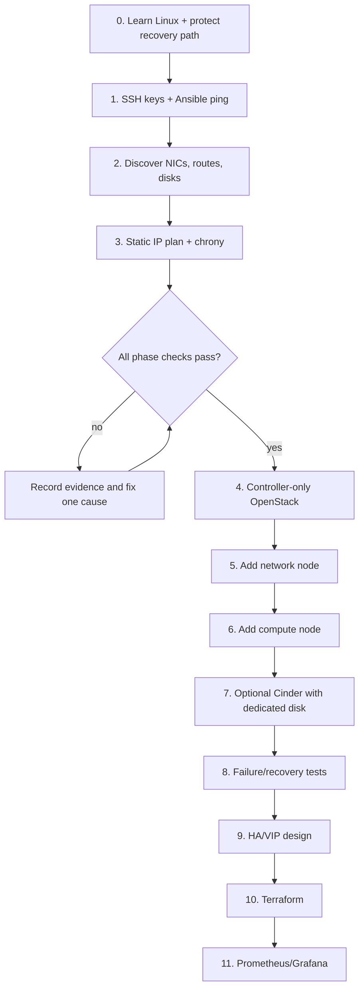

# Lab architecture and flow

## Role assignment for the first working lab

The first target is a functional, non-HA lab:

- Controller: Node 1 (`192.168.0.200`)
- Network: Node 2 (`192.168.0.201`)
- Compute: Node 3 (`192.168.0.202`)
- Management VM: separate address, runs Ansible only

The USB NIC is reserved for a private node-to-node network. Its actual Linux name must be discovered on each host; it may be `enx...`, `eth1`, or another name.

## High-level diagram

```text
                         Management VM
                    Hermes + Git + Ansible
                              |
                 management LAN / SSH / API
       +----------------------+----------------------+
       |                      |                      |
  Node 1 .200             Node 2 .201             Node 3 .202
  Controller              Network                  Compute
  Keystone                Neutron agents           Nova-compute
  Glance                  OVS/Linux bridge         KVM/libvirt
  Placement               DHCP/L3                  Cinder later
       |                      |                      |
       +========= USB NIC private/internal network =========+
```

## Low-level traffic picture

```text
Client/admin
    |
    | management LAN: SSH, Ansible, OpenStack APIs
    v
[Controller .200]
    | Keystone authentication
    | Nova scheduling/API
    | Glance images
    | Placement resources
    |
    +---- internal RPC/database traffic ----+
    |                                       |
[Network .201]                         [Compute .202]
 Neutron server/agents                  nova-compute
 OVS bridges                            libvirt/KVM
 DHCP/L3                                tenant instances
    |
    +---- external/provider bridge (later; exact NIC is site-specific)
```

## Build flow



## The three networks to understand

1. Management/API network: existing LAN, used for SSH and OpenStack API access.
2. Internal/tunnel network: USB NIC, used for node-to-node service and tenant traffic as designed.
3. External/provider network: optional separate path for floating IPs. Do not invent this from the USB NIC until the physical wiring and switch/router behavior are known.

## HA warning

A VIP alone is not HA. A resilient control plane also needs replicated databases, message queues, API services, storage, and tested failover. Keep the first deployment single-controller and learn the services before adding HA complexity.
